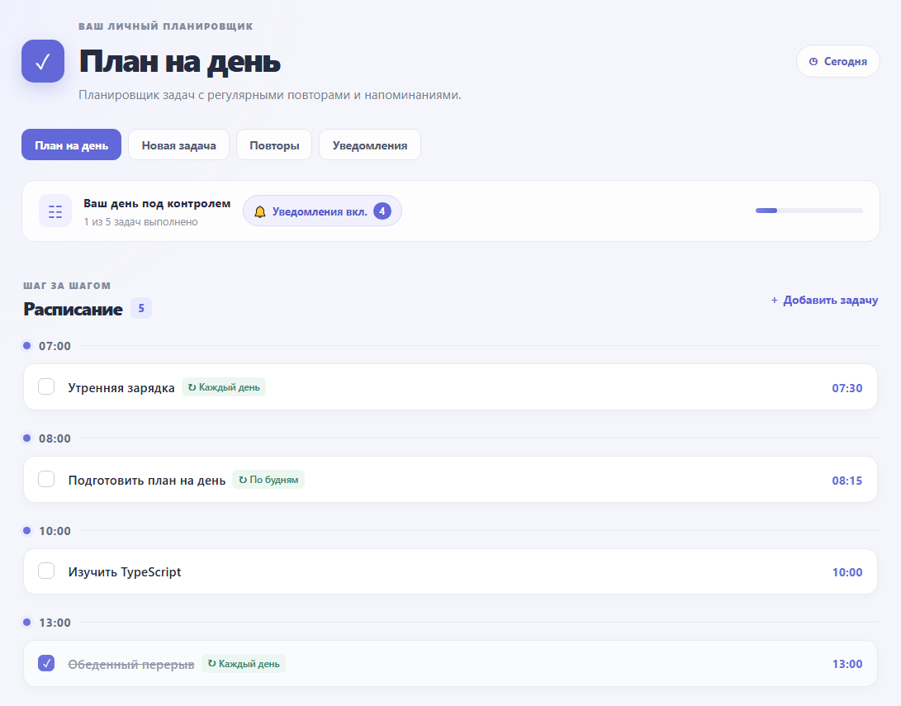
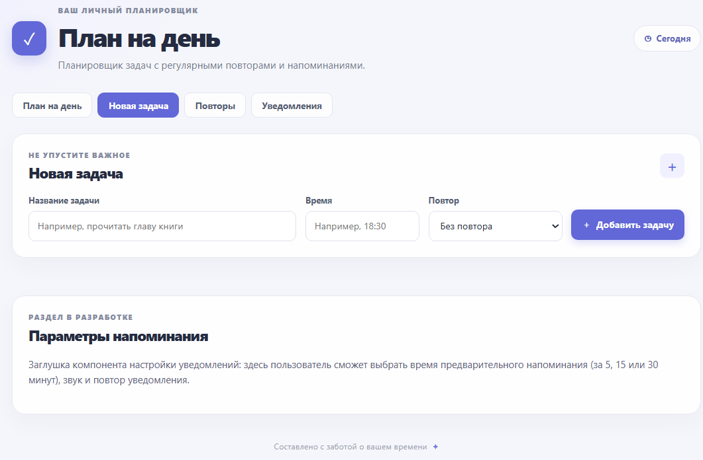
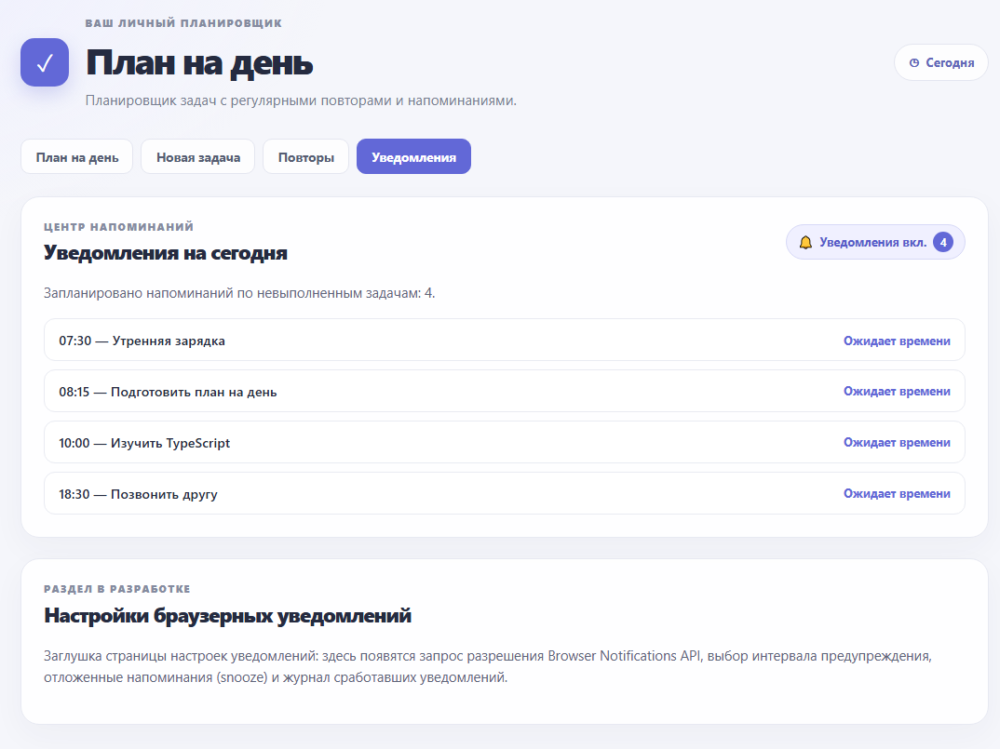
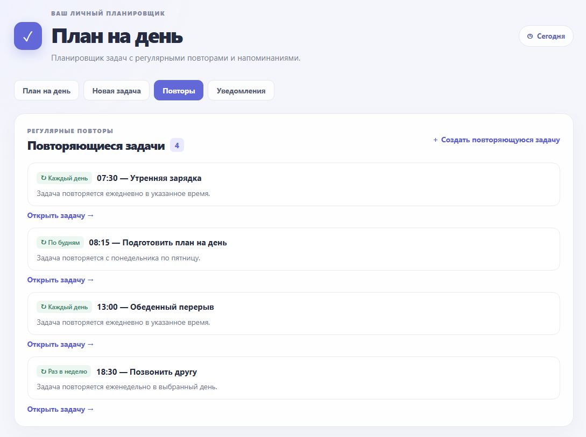

# Разработка планировщика задач на день с уведомлениями и регулярными повторами с использованием библиотеки React

Курсовой проект состоит из двух пакетов на TypeScript (ES-модули, `"type": "module"`): библиотеки общих UI-компонентов `ui-library` и клиентского приложения `frontend` с маршрутизацией на базе `react-router-dom`.

## Документация проекта

- [architecture.md](architecture.md) — архитектура проекта, список библиотек с версиями, описание компонентов и структура роутинга.
- [mvp.md](mvp.md) — функциональные требования к MVP, основной use case и границы первой версии.

## Структура

- `ui-library/` — библиотека компонентов `@my-app/ui-library` (`TaskList`, `TaskForm`, `NotificationBadge`, `RepeatRulePreview`), типы, стили и unit-тесты.
- `frontend/` — React-приложение со страницами «План на день» (`/`), «Новая задача» (`/tasks/new`), «Карточка задачи» (`/tasks/:taskId`), «Повторы» (`/repeats`), «Уведомления» (`/notifications`) и страницей `404`.

## Инструкция по запуску и проверке

Требуются Node.js и npm. Выполняйте команды последовательно из каталогов пакетов.

### 1. Библиотека общих компонентов (`ui-library`)

```bash
cd ui-library
npm install
npm run lint
npm test
npm run test:coverage
npm run build
```

### 2. Основное приложение (`frontend`)

```bash
cd ../frontend
npm install
npm run lint
npm test
npm run test:coverage
npm run build
npm run dev
```

После запуска `npm run dev` откройте локальный адрес Vite из терминала (по умолчанию `http://localhost:5173/`). Перед сборкой и запуском `frontend` в браузере убедитесь, что библиотека `ui-library` собрана командой `npm run build`.

## Примеры работы приложения

Главная страница (план на день и сводка):



Новая задача



Уведомления



Повторения

